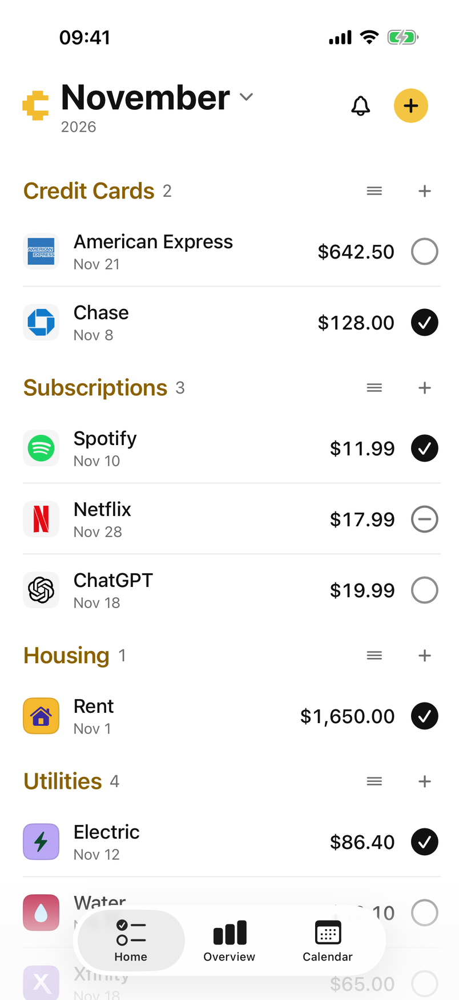
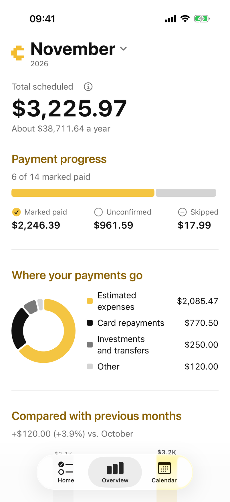
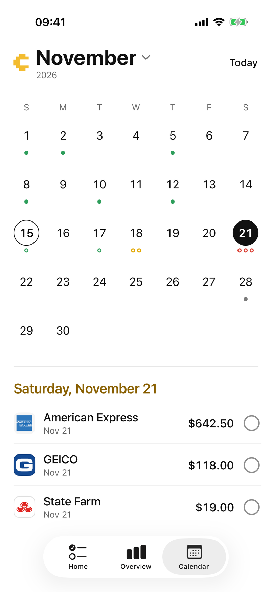

<p align="center">
  
</p>

# Cushn

**Your monthly payments, organized.**

Cushn is a clean, simple iOS app for keeping track of bills, subscriptions, credit card payments, rent, and everything else you need to pay each month.

No spreadsheets. No complicated setup. No bank connections.

Just one place to see what's due, mark what's paid, and stay organized.

**See what's due. Mark what's done.**

Website: [cushn.app](https://cushn.app)

<p align="center">
  
  
  
</p>

## Everything in one place

Managing monthly payments shouldn't require a complicated finance app.

Cushn brings your payments together in a simple, organized checklist. Add what you need to pay, choose a due date, and check it off when you're done.

Whether you're tracking Netflix, rent, utilities, credit cards, or something completely custom, Cushn keeps things straightforward.

## Features

### A simple monthly checklist

See all your payments organized into sections, with recognizable service icons, due dates, amounts, and payment statuses.

Add a payment with just three details:

- Name
- Amount
- Due day

Cushn can suggest a section automatically, and you can change it whenever you want.

### Every month, automatically

Your payment list carries forward into each new month without having to create it again.

Each month keeps its own records. Changes made in December won't rewrite November's history, and payments marked as paid won't automatically be marked paid in the following month.

### Mark payments your way

Keep track of each payment with three simple statuses:

- **Unconfirmed** — You haven't marked it yet.
- **Paid** — You've recorded that it's paid.
- **Skipped** — You're not paying it this month.

Cushn never makes payments or assumes something has been paid.

### Reminders that help

Get optional reminders three days before a payment is due and on the due date.

A built-in notification inbox helps you review reminders, while keeping your payment checklist separate.

### A clearer monthly overview

See your scheduled payments, amounts marked paid, remaining payments, and monthly comparisons.

Simple charts help you understand your monthly obligations without turning Cushn into a complicated budgeting dashboard.

### Calendar view

See which payments are due on particular dates.

Select a day to view its scheduled payments and check their status.

### Make it yours

Organize payments into sections, recognize popular services through their icons, and customize how your checklist is arranged.

Cushn also supports light and dark appearances, with a minimal interface designed for iPhone.

## Private by design

Cushn works offline and doesn't require you to create an account.

Your payment information is stored locally on your iPhone. Cushn doesn't connect to your bank, access your transactions, or process payments.

You stay in control of what you record.

*Cloud synchronization is not included in the initial version.*

## Built for iOS

Cushn is built natively using:

- **Swift** — Application development
- **SwiftUI** — Interface and interactions
- **SwiftData** — Local data persistence
- **Swift Charts** — Monthly visualizations
- **UserNotifications** — Local payment reminders

The app is designed to be lightweight, responsive, and usable without an internet connection.

## Development

Cushn is currently in development and is not yet available on the App Store.

To build it locally, you'll need a Mac with Xcode, [XcodeGen](https://github.com/yonaskolb/XcodeGen), and a compatible iOS simulator or iPhone.

```sh
git clone https://github.com/KrishnaSathvik/cushn-iOS.git
cd cushn-iOS

xcodegen generate
open Cushn.xcodeproj
```

Select a simulator or connected iPhone in Xcode, then build and run the app.

## What Cushn isn't

Cushn is a personal payment organizer, not a banking service.

It doesn't transfer money, automatically pay bills, cancel subscriptions, or verify transactions with financial institutions.

When you mark something paid, Cushn simply remembers your confirmation.

That's the idea: a useful checklist without unnecessary complexity.

## Website

Learn more at [**cushn.app**](https://cushn.app).

---

**Cushn** — See what's due. Mark what's done.
